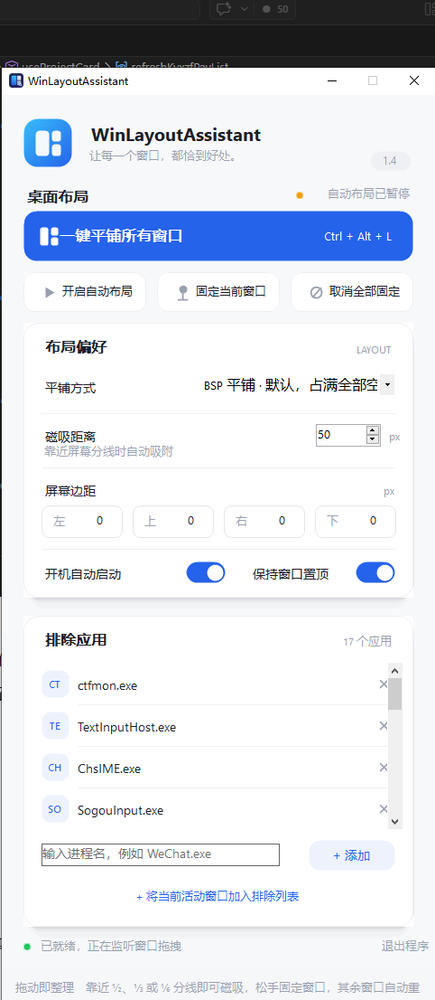

# WinLayoutAssistant — Windows 桌面布局小助手

像 PL/SQL 那个布局按钮一样，一键把桌面上开着的窗口自动排好；也可以手工拖窗口，拖到 1/2、1/3 … 1/9 的位置会磁吸，松手后剩下的窗口自动在剩余空间按原顺序重排。



> **下载说明**：仓库里没有 exe。单文件 exe 有 155 MB，超过了 GitHub 单文件 100 MB 上限，所以请按下面“安装”自己构建，一条命令就行。

## 功能

- **一键平铺**：托盘右键 → 一键平铺，或按 `Ctrl+Alt+L`。按窗口左上角位置排序（先按行从上到下，行内从左到右），多显示器时每个显示器各自排自己的窗口；默认 BSP 平铺，任意窗口数都占满 100%，没有空白格。
- **拖拽磁吸 1/n**：直接拖任意窗口标题栏，宽/高或边缘靠近 1/2、1/3 … 1/9 的线（默认 24px 内）就吸过去，拖动时只在吸附目标上显示一个半透明蓝框，不闪屏。
- **拖拽改大小也磁吸**：从左/右/上/下边拖大窗口时，只吸动的那条边到最近的 1/n 线；改大小只调这一个窗口，不触发其余窗口重排。
- **松手后重排**：拖动移动窗口松手后，该窗口算“已固定”，其余未固定窗口按左上角顺序，在减去所有固定窗口后剩下的最大空闲矩形里重新平铺。
- **屏幕边距（v1.4）**：左 / 上 / 右 / 下四条边各自可设 0–800px，被排除的屏幕区域不参与任何布局——一键平铺、拖拽磁吸、松手重排都遵守同一套边距。典型用法：右边留 300px 给 Rainmeter / 桌面便签栏，顶部留一条给悬浮工具条。
- **开始/停止自动布局**：设置窗大按钮、托盘开关或 `Ctrl+Alt+P`。停止后程序仍在托盘运行，拖动不再磁吸/重排，手动一键平铺仍可用。
- **黑名单**：按 exe 名过滤，默认已拉黑输入法（ctfmon、搜狗、QQ拼音、微信输入法等）和 Windows 搜索/小组件；不知道 exe 名时，点一下那个窗口再点“把当前活动窗口加入黑名单”。
- **本窗口始终置顶**：设置窗默认置顶，可关；开机自启动、磁吸距离、平铺方式（BSP / 网格 / 分列 / 分行）都可在设置里改。
- **退出真正退出**：点 × 是最小化到托盘，托盘右键 → 退出 / 设置窗“退出程序”才是真正退出进程。

## 安装（Windows 10 / 11）

1. 克隆或下载本仓库。
2. 双击 `build.bat`：没装 .NET 8 SDK 会先用 winget 自动装，装完按提示重新双击一次；已装就直接构建。
3. 构建产物在 `publish\WinLayoutAssistant.exe`，双击运行即可（单文件，不用再装 .NET）。
4. 首次运行会弹出设置窗口，点右上角 × 是最小化到托盘（不是退出），托盘右键 → 退出才是真正退出。

> 手动构建：`cd src && dotnet publish -c Release -r win-x64 --self-contained true -p:PublishSingleFile=true -o ..\publish`

## 快捷键

| 快捷键 | 作用 |
|---|---|
| `Ctrl+Alt+L` | 一键平铺所有窗口 |
| `Ctrl+Alt+U` | 取消全部固定 |
| `Ctrl+Alt+P` | 开始 / 停止自动布局 |

- **重排只用“最大剩余矩形”**：固定窗口把屏幕切成几块时，其余窗口只排进其中最大的一块，而不是把所有碎片都利用上。固定窗口贴边放（比如占满左 1/3）时效果最好。
- **边距在多显示器下各自生效**：每个显示器的工作区先各自减去同样的四边像素再布局；边距只是收缩布局区域，不会移动已经在边距区里的窗口。
- **黑名单是按 exe 名匹配的**：如果某个悬浮球/小部件的进程名不在默认黑名单里，用设置窗里的“把当前活动窗口加入黑名单”加一次就行，设置存在 `%AppData%\WinLayoutAssistant\settings.json`。
- **最小化 / 工具窗口不参与**：最小化的窗口、没有标题的窗口、任务栏不参与平铺。
- **提权窗口**：PL/SQL 这类以管理员身份运行的程序，普通权限的本程序移不动它。办法：右键 `WinLayoutAssistant.exe` → 以管理员身份运行。
- **UWP / 部分特殊窗口**（如某些全屏游戏、系统设置页）可能不响应移动，这是 Windows 自身限制。
- **只支持 Win10/Win11**，.NET 8 + WinForms。

## 文件结构

```
win-layout-assistant/
  build.bat                  一键构建
  README.md                  本文件
  Assets/
    AppIcon.ico              应用图标（exe / 窗口 / 托盘，多尺寸）
  src/
    WinLayoutAssistant.csproj
    app.manifest             DPI 感知、asInvoker（不弹 UAC）
    Program.cs               入口
    MainForm.cs              托盘、设置窗、快捷键、一键平铺、重排、边距设置
    WindowHelper.cs          Win32: 枚举/移动窗口
    TileEngine.cs            纯几何: BSP/网格平铺、矩形相减、1/n 磁吸、改大小吸附
    DragMonitor.cs           WinEvent 监听窗口拖拽开始/结束、自动布局开关
    SnapOverlay.cs           拖拽时在吸附目标上画半透明预览框
    UiControls.cs            主题配色、渐变头部、圆角卡片/按钮、托盘菜单配色
    AppSettings.cs           设置（含屏幕边距）存 %AppData%\WinLayoutAssistant\settings.json
```

## 许可证

MIT，自用、改、发给别人都可以。
